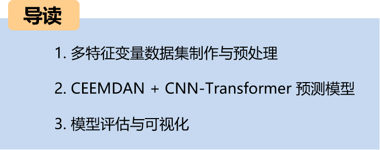
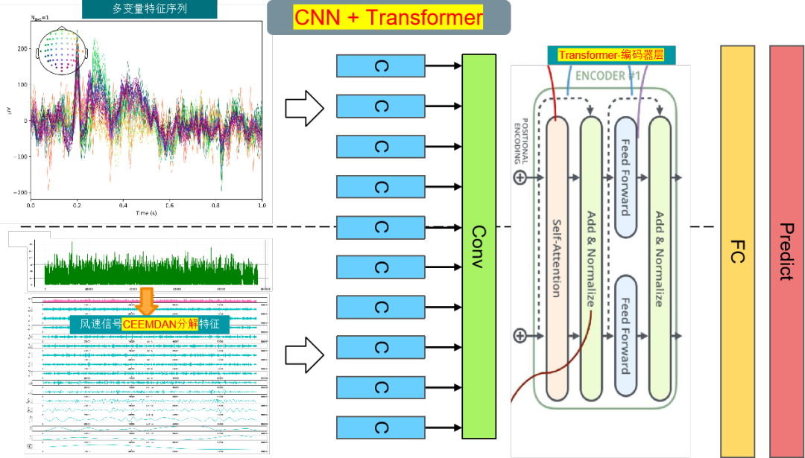
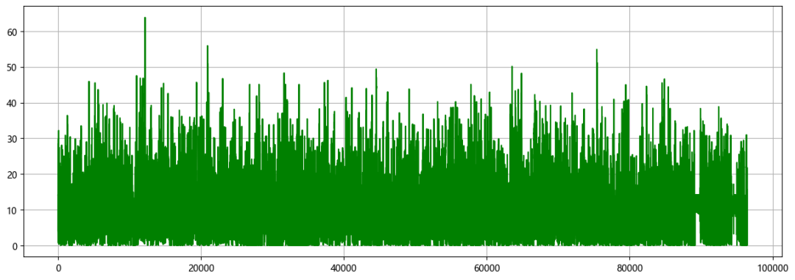
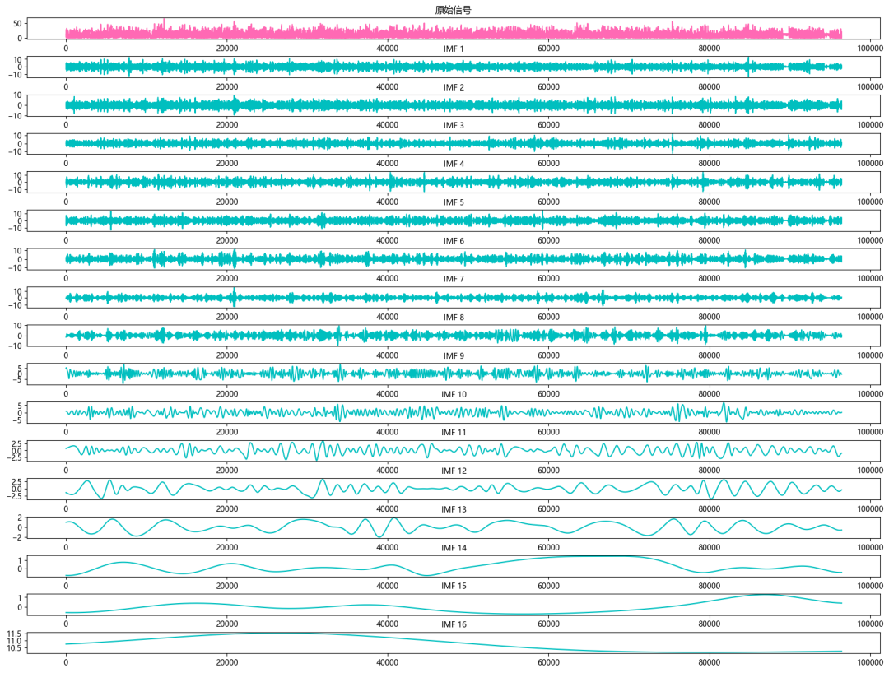
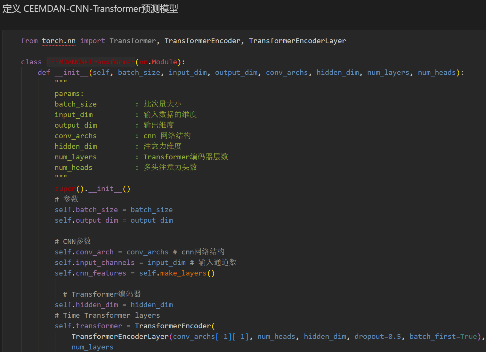
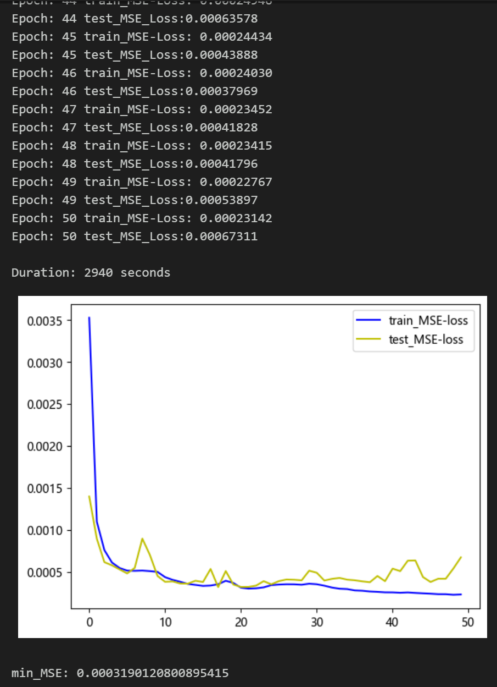
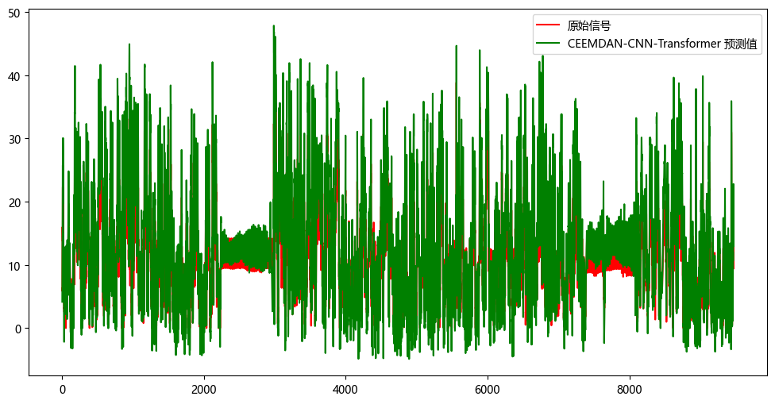
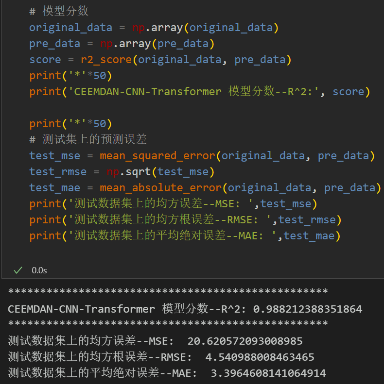
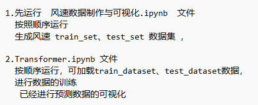

# Multi-Feature Variable Sequence Prediction (VI) CEEMDAN+CNN-Transformer Wind Speed Prediction Model

Single-variable includes the following content:
Including wind speed data, as well as pre-generated datasets and labels for wind speed, all of which can be run.
The CEEMDAN+CNN-Transformer model, with smaller MSE and MAE, has a particularly noticeable effect and significant improvement!
Including data preprocessing code and CEEMDAN decomposition code, as well as complete CEEMDAN+CNN-Transformer model prediction code and visualization code.
Preface
This article introduces a multi-feature variable sequence prediction model CEEMDAN + CNN-Transformer based on the previously introduced wind speed data (Appendix at the end for the dataset), aiming to improve the predictive performance of time series data.
Overall structure of the model: The dataset consists of nine variables including weather, temperature, humidity, pressure, and wind speed. The CEEMDAN algorithm is used to decompose the wind speed sequence, then combine all components and original dataset variables to form an enhanced feature input. A sliding window is created to make the dataset, and multiple variables are used to predict wind speed. Firstly, convolutional pooling operations are performed by CNN to extract spatial features of the feature variables, increasing dimensionality and shortening the sequence length, then these features are sent into Transformer layers to enhance the features, achieving the CNN-Transformer prediction model.
LSTF (Long Sequence Time-Series Forecasting) problem refers to the need to handle long sequences in time series forecasting. In practical applications, time series may contain a very large number of data points. In such cases, traditional time series prediction models may encounter some challenges due to issues with handling long sequences, such as:
Long-term dependency: As the time series data grows, the model needs to be able to capture long-term dependencies and trends.
Computational complexity: Training and predicting for long sequences usually requires more computational resources and time.
Memory consumption: Long sequences typically require a significant amount of memory to store data and model parameters, which can lead to memory exhaustion or performance degradation.
When dealing with LSTF problems, selecting an appropriate window size (window size) is crucial. Selecting the right window size can help the model capture patterns and features better in time series, and for extracting longer dependencies in the sequence, this paper increases the window size to 96 and employs a CNN-Transformer model to fully extract feature information from the sequence.
1 Data Preparation and Preprocessing for Multi-Feature Variables
1.1 Import Data
1.2 CEEMDAN Decomposition
1.3 Data Preparation and Preprocessing
Firstly, merge the original data variables and decomposed components, and divide the training set and test set by a ratio of 9:1
Create the dataset
2 Prediction Model Based on Pytorch's CEEMDAN + CNN-Transformer
2.1 Define the CEEMDAN + CNN-Transformer prediction model
Note: The input wind speed data shape is [256, 96, 23], batch_size=256, where 96 represents the sequence length (the sliding window takes values), and the dimension 23 represents the dimensions of the selected 8 variables and 15 components.
2.2 Set parameters and train the model
Train the model for 50 epochs, MSE is 0.000319, the multi-variable feature CEEMDAN + CNN-Transformer prediction effect is good, after adding CEEMDAN decomposition, the multi-variable prediction effect has been significantly improved, and the performance is superior. By adjusting the model parameters appropriately, the model prediction performance can be further improved.
Note to adjust parameters:
Adjustable parameters include:
- Increase the number of CNN layers and the dimensionality of the hidden layer, and fine-tune the learning rate;
Adjust the number of Transformer encoder layers and dimensions to increase more epochs (note to prevent overfitting)
Change the sliding window length (set an appropriate window length)
3 Model Evaluation and Visualization
3.1 Results Visualization
3.2 Model Evaluation
        \n     \n

## Images

<!-- PAYMENT_BLOCK -->

## Get this dataset

- Payment link (Stripe): [Buy now](https://buy.stripe.com/3cs8yP7sY87d0vu9AB)
- Payment QR code: 

<!-- /PAYMENT_BLOCK -->
